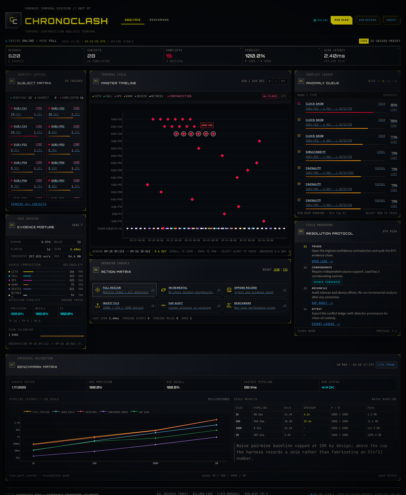
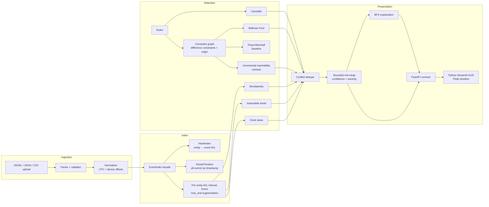
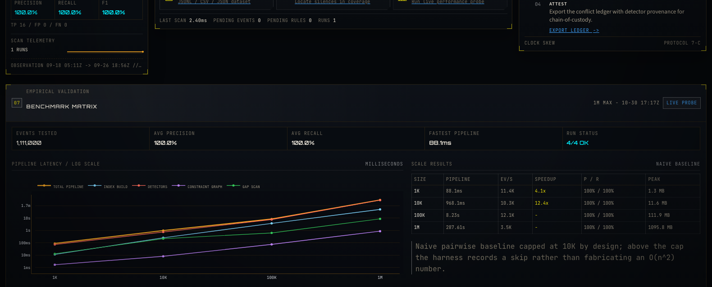

# ChronoClash

**Forensic Temporal Division // Unit 07**  
A temporal contradiction detection engine for multi-source forensic evidence. ChronoClash fuses CCTV, call, GPS, bank, device and witness records into one normalized ledger, then uses hand-built data structures and graph algorithms to find moments where the evidence cannot all be true at once.

> Advanced Data Structures & Algorithms course project. Every core data structure and algorithm in `core/` is implemented from scratch: AVL interval trees, sorted timelines, hash indexes, difference-constraint graphs, Bellman–Ford, Floyd–Warshall, reachability-based incremental rechecks, a bounded min-heap, and BFS explanation.



---

## Contents

- [What it does](#what-it-does)
- [Quick start](#quick-start)
- [Using the HUD](#using-the-hud)
- [API](#api)
- [Data formats and sample datasets](#data-formats-and-sample-datasets)
- [Architecture](#architecture)
- [Algorithms and complexity](#algorithms-and-complexity)
- [Incremental analysis](#incremental-analysis)
- [Benchmarks](#benchmarks)
- [Testing](#testing)
- [Viva notes](#viva-notes)
- [Limitations and responsible use](#limitations-and-responsible-use)
- [References](#references)

---

## What it does

ChronoClash detects four families of temporal contradiction, plus rule-driven constraint cycles:

| Detector | Question it asks | Core data structure / algorithm |
| --- | --- | --- |
| **Impossible simultaneity** | Is one subject recorded in two far-apart places during overlapping time? | Per-entity AVL interval tree augmented with `max_end`; O(log e + k) overlap queries |
| **Impossible travel** | Do adjacent records imply a speed above the configured ceiling? | Sorted per-entity timelines + Haversine distance |
| **Causality violation** | Is an effect timestamped before its cause, or inside a required minimum gap? | Rule scan + difference constraints |
| **Clock skew** | Does one device consistently disagree with independent peers? | Robust median / median-absolute-deviation offset estimate |
| **Constraint cycle** | Is the complete set of rules and observations unsatisfiable? | Difference-constraint graph, Bellman–Ford negative-cycle trace |

The result is a ranked, explainable conflict ledger. Each conflict carries a deterministic signature, severity, source corroboration, confidence, human-readable narrative, and a BFS evidence chain. The HUD exposes full and incremental rescans, timeline lanes, entity status, gap audits, record ingestion, benchmark probes, and JSON/CSV export.

### Highlights

- **No graph/tree shortcut libraries.** No NetworkX, intervaltree, sortedcontainers, SciPy, or similar implementations in the core.
- **Genuinely incremental analysis.** New records only re-run affected entities; new rules only re-relax the subgraph reachable from the new edge.
- **Explainable by construction.** Negative cycles return the event IDs on the cycle, and BFS walks the rule/temporal graph into an ordered evidence chain.
- **Reproducible benchmarks.** Fixed seeds, planted ground truth, `time.perf_counter` timings, `tracemalloc` peaks, JSON + CSV output, and precision/recall scoring.
- **Forensic sci-fi HUD.** Responsive three-column command console built entirely in Python with Streamlit and Plotly: timeline lanes with zoom/pan, conflict callouts, entity status tiles, resolution protocol, and a benchmark matrix.
- **Accessible motion controls.** `prefers-reduced-motion` disables scanline and pulse animation for users who request it.

---

## Quick start

### Requirements

- Python **3.11+** (developed with Python 3.11.17)

Everything, including the HUD, runs in Python. There is no Node.js or npm step.

### 1. Install

From the repository root:

```bash
python3.11 -m venv .venv
source .venv/bin/activate
pip install -r requirements.txt
```

### 2. Backend

```bash
uvicorn backend.app.main:app --host 127.0.0.1 --port 8000
```

The backend bootstraps the bundled 620-event sample case on startup. Open:

- Interactive API docs: <http://127.0.0.1:8000/docs>
- Health check: <http://127.0.0.1:8000/health>

### 3. HUD

In a second terminal, with the same virtual environment:

```bash
streamlit run hud/app.py --server.address 127.0.0.1 --server.port 8501
```

Open <http://127.0.0.1:8501>. The HUD talks to the backend at `http://127.0.0.1:8000/api` by default. Point it elsewhere with:

```bash
CHRONOCLASH_API=http://127.0.0.1:9000/api streamlit run hud/app.py
```

### One-command checks

```bash
# backend + core tests
.venv/bin/python -m pytest -q

# HUD syntax smoke check
.venv/bin/python -m py_compile hud/*.py
```

---

## Using the HUD

### Layout

- **Subject matrix** — every entity, its status (`clean`, `suspect`, `conflicted`), record count, conflict count, and peak severity. Select a tile to filter the timeline lanes or click a subject label in the timeline.
- **Master timeline** — Plotly-rendered lanes with source-colored marks, wheel zoom/pan, hover tooltips, conflict markers, BFS connectors, and a callout for the focused contradiction. Zoom controls are linkable query parameters (`?zoom=in|out|fit`).
- **Anomaly queue** — top-k conflicts ranked by the hand-written min-heap. Select a row for the BFS explanation trace; `?top_k=5|8|12|20` changes the heap capacity.
- **Evidence posture** — case window, rules, planted truth, scan latency, throughput, RSS, source composition, precision/recall/F1, and scan history sparkline.
- **Action matrix** — full rescan, incremental analysis, append record, ingest file, gap audit, benchmark, and JSON/CSV export.
- **Resolution protocol** — triage, corroborate, reconcile, attest.
- **Benchmark matrix** — summary KPIs, log-scale latency chart, scale table, and live-probe controls.

All interactive state lives in Streamlit widgets or query parameters, so a view can be bookmarked or shared. Forms open as fixed HUD overlays above the terminal.

### Useful flows

1. **Run the detector cascade:** `FULL RESCAN` runs every detector and rebuilds the constraint graph.
2. **Append one record:** `APPEND RECORD` inserts an event, reindexes it, and runs only local incremental detectors.
3. **Upload a case:** `INGEST FILE` accepts JSONL, JSON, or CSV. Use *append* to merge without replacing the current case.
4. **Audit gaps:** `GAP AUDIT` lists per-entity periods above the threshold (default 900 s).
5. **Explain a conflict:** click a queue row or a timeline callout. The modal shows severity, confidence, sources, offset, rule metadata, and the BFS evidence chain.
6. **Probe performance:** `BENCHMARK` runs a synchronous quick benchmark (`persist=false`), writes under `backend/results/runs/<timestamp>/`, and leaves the committed canonical benchmark untouched. `RESTORE CANONICAL` reloads `/bench/latest`.
7. **Export:** JSON bundles include metadata, rules, ground truth and conflicts; CSV exports the ranked conflict ledger.

The three-column console stacks into a single column below 1100 px and remains usable at phone widths. Motion is disabled automatically under `prefers-reduced-motion`.

---

## API

All routes are available both at `/` and under `/api` (the `ApiPrefixMiddleware` strips the prefix). The Streamlit HUD uses `/api`.

| Method | Path | Purpose |
| --- | --- | --- |
| `GET` | `/health` | Liveness and event count |
| `GET` | `/state` | Full HUD state: entity status, counts, evaluation, window, telemetry |
| `GET` | `/timeline?entity=&start=&end=&limit=` | Filtered timeline records with embedded conflict IDs |
| `POST` | `/upload` | Multipart upload (`file`, `append`, `analyze`); JSONL/JSON/CSV |
| `POST` | `/analyze?mode=full\|incremental` | Re-run detection |
| `POST` | `/events` | Append one validated event and run incremental analysis |
| `GET` | `/conflicts?top_k=8` | Ranked conflicts from the bounded min-heap |
| `GET` | `/conflicts/{id}/explain` | BFS evidence chain and narrative |
| `GET` | `/entities` | Entity summaries and status counts |
| `GET` | `/gaps?threshold_s=&entity=&limit=` | Evidence gaps |
| `POST` | `/bench?persist=true\|false` | Synthetic benchmark harness |
| `GET` | `/bench/latest` | Committed canonical benchmark JSON |
| `GET` | `/export?format=json\|csv` | Download the conflict ledger |

### Examples

```bash
curl http://127.0.0.1:8000/state | jq

curl -X POST 'http://127.0.0.1:8000/analyze?mode=incremental'

curl -X POST http://127.0.0.1:8000/events \
  -H 'content-type: application/json' \
  -d '{
    "id": "EV-VIVA-001",
    "timestamp": "2026-09-23T12:00:00Z",
    "duration_s": 120,
    "entity": "SUBJ-001",
    "lat": 51.5074,
    "lon": -0.1278,
    "source": "gps",
    "device_id": "GPS-001",
    "action": "POSITION_FIX",
    "reliability": 0.91
  }'

curl http://127.0.0.1:8000/conflicts?top_k=5 | jq

curl 'http://127.0.0.1:8000/upload?append=false' \
  -F 'file=@backend/data/sample_case.jsonl' \
  -F 'analyze=true'

curl -X POST 'http://127.0.0.1:8000/bench?persist=false' \
  -H 'content-type: application/json' \
  -d '{"sizes":[1000,10000],"contradictions":8,"seed":424242}'
```

### Event schema

```json
{
  "id": "EV-00000001",
  "timestamp": "2026-09-20T12:34:56Z",
  "duration_s": 90.0,
  "entity": "SUBJ-001",
  "lat": 51.5074,
  "lon": -0.1278,
  "source": "gps",
  "device_id": "GPS-001",
  "action": "POSITION_FIX",
  "reliability": 0.94
}
```

- `source` is one of `cctv`, `call`, `gps`, `bank`, `device`, `witness`.
- All timestamps are normalized to UTC. Naive ISO strings are interpreted as UTC.
- `duration_s` is device-measured and is not changed by clock-offset correction.
- Event IDs are unique. Appending an existing ID is rejected or skipped depending on the endpoint.
- Rules use `precedes`, `min_gap`, or `max_gap` with `event_a`, `event_b`, `delta_s`.
- Ground truth items carry `type`, `event_ids`, optional `device_id`, and an optional `note`; they are used only for scoring.

### Upload formats

1. **JSONL** — one record per line. Record types: `meta`, `event`, `rule`, `ground_truth`.
2. **JSON bundle** — `{ "meta": {...}, "events": [...], "rules": [...], "ground_truth": [...] }`.
3. **CSV** — event columns only (no rules or ground truth). The importer accepts flexible header aliases and reports warnings.

---

## Data formats and sample datasets

### Bundled case

`backend/data/sample_case.jsonl` is generated with seed `7` and loaded automatically:

| Property | Value |
| --- | ---: |
| Events | **620** |
| Entities | **28** |
| Rules | **12** |
| Planted contradictions | **16** |
| — impossible simultaneity | 5 |
| — impossible travel | 4 |
| — causality | 4 |
| — clock skew | 3 |
| Corroboration records | 133 |
| Span | 9 days |
| Sources | 6 |

The sample contains three isolated clock-skew subjects (`CAM-S01`–`CAM-S03`), each with two independent peer devices on true UTC. The expected API result is **16 conflicts**, precision **1.0**, recall **1.0**.

`backend/data/sample_mini.jsonl` is a smaller 120-event case for quick demos and classroom walkthroughs.

### Generate more

```bash
# 500 events, 12 contradictions
.venv/bin/python -m core.generator \
  --events 500 --contradictions 12 --seed 42 \
  --out backend/data/custom_case.jsonl

# a larger case; JSON bundle for full rules + ground truth
.venv/bin/python -m core.generator \
  --events 5000 --contradictions 40 --seed 99 \
  --out backend/data/case_5k.json --format json
```

The generator intentionally separates planted contradictions from clean timelines so precision/recall has a trustworthy denominator. It reserves slots for anomalies, generates clean per-entity sequences, adds cross-source corroboration, isolates skew devices, and inserts satisfied control rules before deduplicating and sorting.

---

## Architecture



### Layer boundaries

- `core/` is a standalone, web-independent DSA library. It can be imported from a notebook or CLI.
- `backend/app/` owns HTTP contracts, upload parsing, and stateful orchestration. It contains no detector internals.
- `hud/` is a Python-only Streamlit client. It never computes contradictions; it renders API results with Plotly and hand-written HTML/CSS panels.
- The benchmark harness reuses `core/` directly, so benchmarked code and production detection share the same implementations.

### Why a per-entity interval forest?

A simultaneity contradiction is only meaningful **within one subject**: two records for different people at different places are not a contradiction. A single global interval tree would return many irrelevant overlaps and force entity filtering after the query. Instead, ChronoClash maintains one AVL interval tree per entity. Overlap queries for an event touch only that entity's tree, while the facade still exposes a forest-wide query for experiments. Incremental inserts update one tree in O(log e) instead of rebuilding a global structure.

Each node is augmented with `max_end` over its subtree. A query can prune an entire subtree whose latest interval ends before the query starts, giving `O(log e + k)` for `k` reported overlaps rather than a linear scan.

### Why a virtual origin in the constraint graph?

Only events referenced by a rule become graph nodes. To test whether their **observed** timestamps satisfy the rules, each node is pinned to its observation with two zero-sum edges through `__ORIGIN__`:

```text
origin -> e   weight  t_e
e -> origin   weight -t_e
```

This turns "the observations themselves are part of the constraint system" into ordinary shortest-path edges. A negative cycle then means the rules and observations cannot coexist. Without the origin, the graph could shift every timestamp by a constant and miss contradictions that come from the recorded times.

---

## Algorithms and complexity

Notation: `n` = events, `e` = events in one entity's tree, `r` = rules, `c` = conflict candidates, `k` = requested top-k, `V`/`E` = graph nodes/edges, `g` = gaps reported. All structures are hand-written.

| Operation / algorithm | Where | Time | Space |
| --- | --- | --- | --- |
| Timestamp parsing + normalization + offset | `normalize.py` | O(n) | O(n) |
| Hash index insert / lookup | `index.py` | O(1) expected | O(n) |
| Sorted timeline build | `index.py` | O(n log n) | O(n) |
| Sorted timeline range query | `index.py` | O(log n + k) | O(k) |
| Sorted timeline insert / delete | `index.py` | O(n) due to shifts | O(1) extra |
| Per-entity AVL interval tree build | `index.py` | O(e log e) sorting + O(e) build | O(e) |
| Interval tree overlap query | `index.py` | O(log e + k) | O(k) |
| Interval tree insert / delete | `index.py` | O(log e) | O(log e) recursion |
| Simultaneity detector, full | `detectors.py` | O(n log e + K) for K emitted pairs | O(n + K) |
| Impossible-travel detector | `detectors.py` | O(n) scan on indexed lanes; O(n log n) if per-entity sorting is included | O(n) |
| Causality detector | `detectors.py` | O(r) | O(r) |
| Clock-skew detector | `detectors.py` | O(n·w), w ≤ 64 neighbour cap | O(n) |
| Constraint graph build | `constraint_graph.py` | O(V + E) | O(V + E) |
| Bellman–Ford negative cycle | `constraint_graph.py` | O(V·E) | O(V + E) |
| Floyd–Warshall baseline | `constraint_graph.py` | O(V³) | O(V²) |
| Incremental recheck, per new rule edge | `constraint_graph.py` | O(V′·E′) reachable subgraph; worst case O(V·E) | O(V + E) |
| Conflict scoring | `ranking.py` | O(c·(log n + k_window)) | O(c) |
| Bounded top-k min-heap | `ranking.py` | O(c log k) | O(k) |
| BFS evidence explanation | `explain.py` | O(V_e + E_e + r), visit cap 600 | O(V_e + E_e) |
| Gap scan | `gaps.py` | O(n + g log g) after indexing; O(n log n) if sorting | O(g) |
| Synthetic generator | `generator.py` | O(n log n) final sort | O(n) |
| Benchmark harness | `bench.py` | dominated by detectors + graph baselines | measurement-dependent |

### Why the bounded min-heap?

A dashboard needs the strongest `k` conflicts, not a fully sorted ledger. Streaming each candidate through a min-heap of capacity `k` costs `O(c log k)` and retains only `O(k)` objects. A full sort would be `O(c log c)`. The heap root is the weakest retained conflict, so replacement is a single sift-down.

### Why Floyd–Warshall at all?

Bellman–Ford is the production engine. Floyd–Warshall is included as an all-pairs correctness baseline and as a didactic comparison. It is deliberately capped in the benchmark (`floyd_node_cap`) because cubic growth becomes impractical at realistic graph sizes. The reported skip is explicit; no synthetic number is fabricated.

### Naive baseline

`naive_simultaneity` performs the same-entity pairwise scan with no interval tree. It is the honest `O(n²)` worst-case baseline and is capped at 10,000 events in the harness. Above the cap, the result records a skip rather than pretending an `O(n²)` run completed.

---

## Incremental analysis

A new event is inserted into the hash index, the sorted timeline, and its entity's AVL tree. Incremental detection then:

1. collects the affected entities and new event IDs;
2. queries overlaps only for new records on those entities (simultaneity);
3. checks only predecessor/successor edges around new records (travel);
4. runs rule causality only for new rules;
5. scans only affected entities/devices (clock skew);
6. adds new rule endpoints and edges to the maintained constraint graph;
7. BFSes forward reachability from each new rule edge's destination and runs Bellman–Ford on that induced subgraph;
8. merges new conflicts with the existing ledger by deterministic signature.

A new negative cycle must use at least one newly added edge. If `u -> v` is new, a cycle through it exists exactly when `shortest(v -> u) + w(u,v) < 0`, or when the reachable subgraph already contains a negative cycle. This is why the recheck is sound without recomputing every shortest path from the origin. If the affected subgraph is the entire graph, the algorithm degrades gracefully to full Bellman–Ford; the README and code state that honestly.

Rule deduplication uses stable rule IDs, and conflict deduplication uses a signature over kind, entity/device, and sorted event IDs. When duplicates collide, the higher-ranked kind wins deterministically.

---

## Benchmarks

### Method

Run from the repository root:

```bash
.venv/bin/python -m core.bench \
  --sizes 1000 10000 100000 1000000 \
  --out backend/results
```

The harness records:

- generation, normalization, index build, each detector, constraint graph, ranking and gap-scan timings with `time.perf_counter`;
- `tracemalloc` peak memory (MiB) for generation, index, and the complete pipeline;
- precision/recall/F1 against planted ground truth;
- interval-tree simultaneity vs the capped naive pairwise baseline;
- Bellman–Ford, incremental recheck, and Floyd–Warshall graph baselines.

`full_analysis_ms` is the **detector + graph + ranking + gap** pipeline. Generation, normalization and index construction are reported separately because they are ingestion costs, not contradiction-detection costs. This keeps throughput numbers interpretable.

Canonical artifacts:

- `backend/results/chronoclash_bench.json`
- `backend/results/chronoclash_bench.csv`

Hardware for the result below: **Apple M1 Pro, 16 GB RAM, macOS 27.2, Python 3.11.17**, single process, no GPU. Timings are machine-dependent; ratios and correctness are the reproducible parts.

<!-- BENCH:START -->
Canonical run: **2026-10-30T17:17:30Z**, seed **424242**, 8 planted contradictions per size, all four sizes completed (`4/4 OK`, precision = recall = 1.0).

| Events | Generate | Normalize | Index build | Detectors | Graph | Rank | Gaps | **Full pipeline** | Throughput | Peak trace |
| ---: | ---: | ---: | ---: | ---: | ---: | ---: | ---: | ---: | ---: | ---: |
| 1K | 266.8 ms | 63.6 ms | 11.4 ms | 71.9 ms | 1.7 ms | 1.7 ms | 12.8 ms | **88.1 ms** | 11,352 ev/s | 1.31 MiB |
| 10K | 3.04 s | 1.41 s | 251.3 ms | 744.7 ms | 8.0 ms | 1.4 ms | 214.0 ms | **968.1 ms** | 10,329 ev/s | 11.63 MiB |
| 100K | 60.18 s | 14.82 s | 3.66 s | 7.51 s | 73.6 ms | 28.6 ms | 622.3 ms | **8.23 s** | 12,146 ev/s | 111.89 MiB |
| 1M | 441.29 s | 151.83 s | 49.67 s | 278.03 s | 863.1 ms | 189.0 ms | 8.53 s | **287.61 s** | 3,477 ev/s | 1,095.84 MiB |

Ingestion is reported separately from `full_analysis_ms` (detectors + constraint graph + ranking + gaps). The 1M detector split was: simultaneity 49.45 s, impossible travel 50.08 s, causality 1.02 s, clock skew 177.48 s. Clock skew dominates at 1M because the seeded generator keeps a fixed 12-day span while adding events, so each device's 300 s neighbourhood is saturated and the capped 64-neighbour scan runs to its limit. This is a density effect, not quadratic growth; all four sizes still returned the same 8 planted conflicts with no false positives.

| Events | Naive pairwise | Interval tree | Speedup | Bellman–Ford | Incremental | Floyd–Warshall |
| ---: | ---: | ---: | ---: | ---: | ---: | ---: |
| 1K | 104.9 ms | 25.9 ms | **4.06×** | 28.7 ms | 28.4 ms (1.01×) | 525.4 ms |
| 10K | 4.13 s | 331.8 ms | **12.44×** | 231.8 ms | 239.8 ms (0.97×) | 8.79 s |
| 100K | skipped | 3.41 s | — | 256.6 ms | 241.1 ms (1.06×) | 26.29 s |
| 1M | skipped | 49.45 s | — | 413.2 ms | 699.2 ms (0.59×) | 24.66 s |

The naive baseline is intentionally skipped above 10K events; O(n²) at 1M is not a meaningful measurement. Graph timings use the bounded 160-node stress graph, so they demonstrate the algorithms rather than scale with event count; incremental recheck paths can occasionally lose to full Bellman–Ford on such a small graph because of bookkeeping overhead.
<!-- BENCH:END -->



### Reading the numbers

- **Precision/recall of 1.0** means the synthetic planted conflicts were all recovered with no false positives under the seeded generator. This is a controlled harness, not a claim about messy real-world evidence.
- **Naive speedup** is only reported up to 10K events. It measures the interval tree's pruning advantage, not a general constant-factor speedup.
- **Incremental vs full** is most visible in the API with a warm case: a new event touches one entity, while a full scan walks every entity. The graph benchmark's incremental path is intentionally measured on a small stress graph where reachability is large, so it demonstrates the mechanism rather than a best-case ratio.
- **Memory** uses `tracemalloc`, which tracks Python allocations and can differ from RSS. The HUD's RSS tile reads the process resident set separately.

### Live HUD probes

The HUD's benchmark modal runs a synchronous quick probe and writes to `backend/results/runs/<timestamp>/` with `persist=false`. It never overwrites the committed canonical artifacts. `RESTORE CANONICAL` reloads `/bench/latest`.

---

## Testing

```bash
.venv/bin/python -m pytest -q
```

**44 tests** cover:

| File | Coverage |
| --- | --- |
| `tests/test_normalize.py` | Timestamp parsing, UTC correction, offset sign, invalid input |
| `tests/test_index.py` | Hash index, sorted timeline, AVL invariants, overlap pruning, insertion/deletion |
| `tests/test_detectors.py` | All four detectors, thresholds, canonical pairs, incremental filters |
| `tests/test_constraint_graph.py` | Rule encoding, origin pinning, negative cycles, Floyd–Warshall agreement, incremental rechecks |
| `tests/test_ranking_explain_gaps.py` | Min-heap capacity/order, confidence scoring, BFS chains, gap boundaries |
| `tests/test_generator.py` | Seeds, event counts, ground-truth protection, skew isolation |
| `tests/test_api.py` | Every API route, upload formats, append behavior, incremental event, export, benchmark semantics |

HUD quality gate (Python only):

```bash
.venv/bin/python -m py_compile hud/*.py
```

---

## Viva notes

### 1. Interval tree vs sorted list

**Sorted timeline.** A sorted array of `(timestamp, event_id)` is excellent when the workload is mostly point/range queries over *start times*: build in `O(n log n)`, query in `O(log n + k)` with binary search, iterate deterministically. But an event is an **interval** `[start, end)`. A range query on start times misses an interval that started earlier and is still active. To find all overlaps you may have to scan backwards until no earlier interval can reach the query—linear in the worst case. Insert/delete is also `O(n)` because everything after the position shifts.

**Interval tree.** An AVL tree keyed by start time stores `max_end` in every subtree. During an overlap query, if a subtree's `max_end <= query_start`, the whole subtree is pruned. Query is `O(log e + k)`; insert/delete is `O(log e)`. The cost is extra pointer memory and rotation bookkeeping.

**Why a forest?** Contradictions are per subject. One global tree would produce cross-subject overlaps that the detector must discard. One tree per entity keeps each query focused, allows incremental insertion into only one structure, and still supports a forest-wide diagnostic query via the facade.

**When would a sorted list win?** Static evidence, mostly start-time range queries, few overlap queries, and tight memory. ChronoClash is designed for dynamic ingestion and many overlap queries, so the forest is the better fit. The naive pairwise baseline exists to quantify that choice rather than assert it.

### 2. Negative cycles and difference constraints

Represent each event's true time as a variable `x_e`. Rules become difference constraints:

- `min_gap(a, b, d)` / `precedes(a, b, d)`: `x_b - x_a >= d` → edge `b -> a` with weight `-d`.
- `max_gap(a, b, d)`: `x_b - x_a <= d` → edge `a -> b` with weight `d`.

Observations are pinned with a virtual origin:

- `origin -> e` weight `t_e` (`x_e <= t_e`)
- `e -> origin` weight `-t_e` (`x_e >= t_e`)

Any feasible assignment implies no negative cycle. If a negative cycle exists, summing the inequalities around the cycle gives `0 < 0`—a contradiction. Bellman–Ford relaxes all edges `V` times; if a relaxation still changes a distance on the `V`-th pass, a negative cycle exists. Following predecessor pointers for `V` steps lands inside the cycle, and the repeated segment is traced. ChronoClash returns the cycle's event IDs (excluding the synthetic origin) so the analyst can see exactly which records conflict.

Floyd–Warshall is the all-pairs baseline: a negative diagonal `dist[i][i] < 0` proves a cycle. It is `O(V³)`/`O(V²)` and capped in benchmarks.

### 3. Clock skew

A clock offset is **seconds ahead of true UTC**. A camera that stamps 10:00:00 when true UTC is 09:59:30 has offset `+30`; correction is `recorded - 30`. Duration is measured by the device and is unaffected by the offset.

For each device record, ChronoClash finds the nearest same-entity record from a **different source and different device** inside a time window. The signed delta is one clock observation. Per device, the detector takes the median delta and the median absolute deviation (MAD). It flags skew only when:

- at least 4 observations exist;
- `|median| >= 120 s`;
- `MAD <= 40 s` (a coherent offset, not random drift).

The median resists a single bad witness statement; the MAD rejects devices whose apparent offset jumps around. The generator isolates each skew subject and gives it two peer devices on true UTC, so the detector can identify *which* clock is wrong rather than accusing both sides of a symmetric disagreement.

**Why not auto-correct?** `estimate_device_offsets` and `apply_offsets` are available for advisory correction, but the engine does not silently rewrite evidence. An inferred offset is itself a finding; automatic correction could erase the contradiction the analyst needs to see. Callers can supply explicit `meta.clock_offsets` when a device's error is independently established.

**Limitations.** A timezone misconfiguration appears as a large constant offset and will be flagged as skew. That may be correct operationally (timestamps are not UTC) but the narrative should distinguish timezone error from malicious retiming. A device with sparse corroboration cannot be assessed confidently; the minimum-sample rule prevents overclaiming.

### 4. Incremental novelty

The incremental constraint check is not "run full Bellman–Ford and pretend." After adding new rule edges to a maintained graph, for each new edge `u -> v`:

1. BFS forward from `v` to obtain the reachable set `R`.
2. Run Bellman–Ford restricted to `R`.
3. If a negative cycle is reachable from `v`, record it.
4. Otherwise, if `u ∈ R` and `shortest(v -> u) + w(u,v) < 0`, the new edge closes a cycle; reconstruct `v ... u -> v`.

Only the reachable subgraph is relaxed, so historical nodes untouched by the new edge are skipped. A cycle introduced by the new edge must contain that edge, which is why checking only new edges is complete. If `R` is the entire graph, the complexity matches full Bellman–Ford—an honest worst case, not a claim of asymptotic improvement. The same idea drives event-level incremental detection: only affected entities and device neighbourhoods are rescanned.

### 5. Precision, recall, and the ground truth

The generator plants contradictions with known event-ID sets (or a known skew device ID) and keeps those IDs protected during trimming. A detection is a true positive only if its signature matches the planted truth set:

- event-based conflicts use the exact event-ID set;
- clock skew matches on `device_id`.

Duplicates are collapsed by signature before scoring. Precision = `TP / (TP + FP)`, recall = `TP / (TP + FN)`, F1 is their harmonic mean. A perfect score on the synthetic case means the implementation recovers the planted faults without extra alerts; it does **not** prove performance on real, noisy evidence.

### 6. Comparison to related tools

| Tool | Focus | How ChronoClash differs |
| --- | --- | --- |
| **Timesketch** (Google, open source) | Collaborative forensic timeline analysis: sketches, multiple timelines, search, tags, comments, stars, analyzers, typically backed by Plaso/OpenSearch. | ChronoClash is contradiction-first rather than collaboration-first. It does not aim to replace a timeline warehouse; it adds a deterministic detector cascade, a difference-constraint graph, incremental rechecks, a bounded ranking heap, and BFS explanations over a compact case. |
| **CAT Detect** (Marrington et al., DFRWS 2011) | Detects inconsistency in computer-activity timelines by checking events against happened-before/precondition rules; an important conceptual ancestor. | CAT Detect's rules were statically defined in code and focused on computer activity. ChronoClash generalizes to weighted difference constraints, pins observations with a virtual origin, returns negative-cycle event IDs, supports incremental reachability, ranks candidates, and exposes a live API/HUD. |
| **TimeSleuth** (Snitch-1302 / Python projects) | Reconstructs and visualizes filesystem timelines from disk images using pytsk3; extracts raw events, abstracts them, and supports investigator filtering. | TimeSleuth is an extraction/visualization aid for host filesystem timestamps. ChronoClash assumes normalized multi-source records and focuses on cross-source temporal contradictions and constraint solving. The two are complementary: extract and normalize with a TimeSleuth-style tool, then reason over the combined ledger with ChronoClash. |

### 7. Why are all data structures hand-written?

The project brief forbids library implementations of the core DSA. More importantly, the viva can trace every rotation, relaxation, heap sift, and BFS edge. The only third-party runtime dependencies are FastAPI/Starlette/Pydantic for HTTP and Streamlit/Plotly/pandas/requests for the HUD; the algorithmic core imports only the Python standard library.

### 8. What would you do next?

- Add a persistent store and case versioning (the current engine is intentionally in-memory).
- Add provenance/chain-of-custody signatures for every ingested record.
- Replace the synthetic generator with adapters for Plaso, CSV exports, and STIX/JSON.
- Add property-based tests for AVL invariants and incremental/full equivalence at larger scales.
- Add a worker queue for million-record uploads so the HTTP request is not synchronous.
- Calibrate thresholds against labelled real cases and report confidence intervals, not just point estimates.

---

## Limitations and responsible use

- **Synthetic evaluation.** Precision/recall results come from planted, isolated faults. Real evidence has missing data, ambiguous entities, duplicate devices, and adversarial timestamps.
- **Single-process, in-memory.** Uploads are held in RAM. The 250 MB upload limit and 1M benchmark are stress demonstrations, not a production capacity plan.
- **No authentication or persistence.** Do not expose this service on an untrusted network. It is a course project, not a chain-of-custody system.
- **Heuristic thresholds.** The 250 m/s speed ceiling, 80 m location epsilon, 120 s skew threshold, and 40 s MAD ceiling are configurable assumptions. A forensic report must record the values used.
- **Absolute-time precision.** The graph pins observed epoch seconds; differences are what matter. Float64 is sufficient for the synthetic spans used here, but production systems should define timestamp precision and rounding explicitly.
- **Explainability is not proof.** A BFS chain shows a plausible evidence path; it does not establish guilt, intent, or admissibility.

---

## Repository layout

```text
chronoclash/
├── core/                      # standalone, web-independent DSA library
│   ├── schema.py              # dataclasses + conflict signatures
│   ├── normalize.py           # UTC + device offset correction
│   ├── index.py               # hash index, sorted timeline, AVL interval forest
│   ├── detectors.py           # four contradiction detectors
│   ├── constraint_graph.py    # difference constraints, BF, FW, incremental
│   ├── ranking.py             # confidence scoring + bounded min-heap
│   ├── explain.py             # BFS evidence chain
│   ├── gaps.py                # per-entity gap detection
│   ├── generator.py           # seeded synthetic dataset + planted truth
│   └── bench.py               # benchmark harness
├── backend/
│   ├── app/                   # FastAPI routes, schemas, engine, ingestion
│   ├── data/                  # bundled sample cases
│   └── results/               # canonical benchmark JSON/CSV
├── hud/
│   ├── app.py                 # Streamlit terminal, actions, overlays
│   ├── render.py              # HTML panels + Plotly figures
│   ├── client.py              # FastAPI client
│   ├── formatting.py          # formatting/query helpers
│   └── assets/                # HUD theme, Streamlit overrides, fonts
├── tests/                     # pytest suite
├── docs/                      # README screenshots
├── .streamlit/config.toml     # HUD theme
├── requirements.txt
├── pyproject.toml
└── README.md
```

---

## References

- Timesketch — collaborative forensic timeline analysis: <https://timesketch.org/>
- Marrington, Baggili, Mohay & Clark, *CAT Detect (Computer Activity Timeline Detection): A tool for detecting inconsistency in computer activity timelines*, DFRWS 2011, *Digital Investigation* 8S, S52–S61. DOI: [10.1016/j.diin.2011.05.007](https://doi.org/10.1016/j.diin.2011.05.007)
- TimeSleuth — forensic timeline analysis: <https://github.com/Snitch-1302/Time-Sleuth> and the `timesleuth` Python package.
- Bellman, R. (1958). *On a routing problem.* Quarterly of Applied Mathematics.
- Floyd, R. W. (1962). *Algorithm 97: Shortest path.* Communications of the ACM.

---

**ChronoClash // Forensic Temporal Division**  
*Temporal contradiction analysis terminal — evidence does not lie, but it does disagree.*
